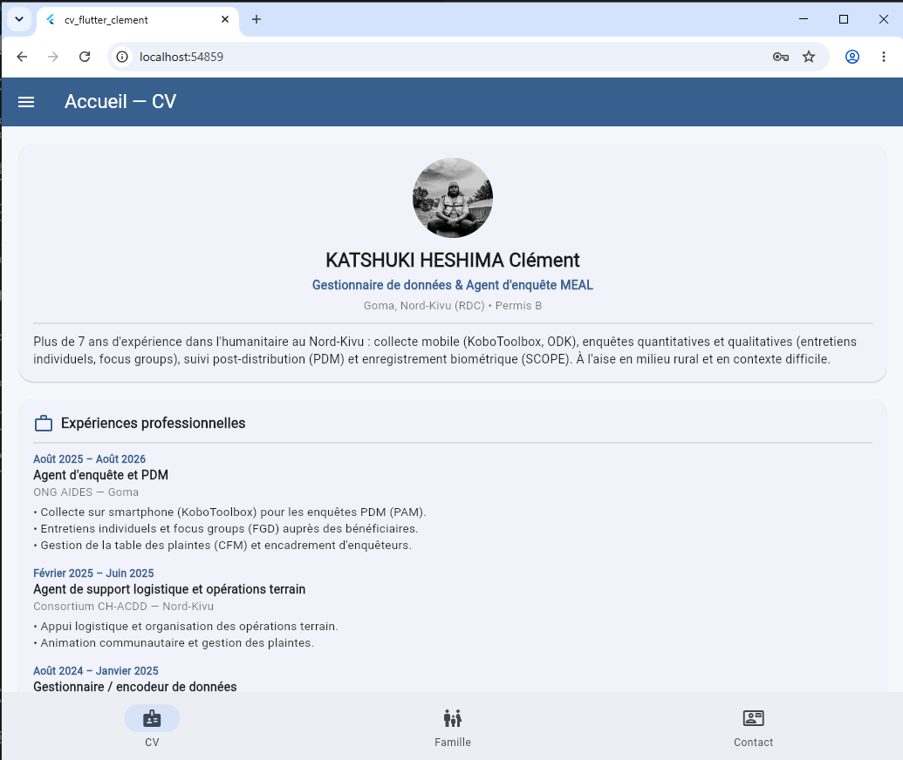
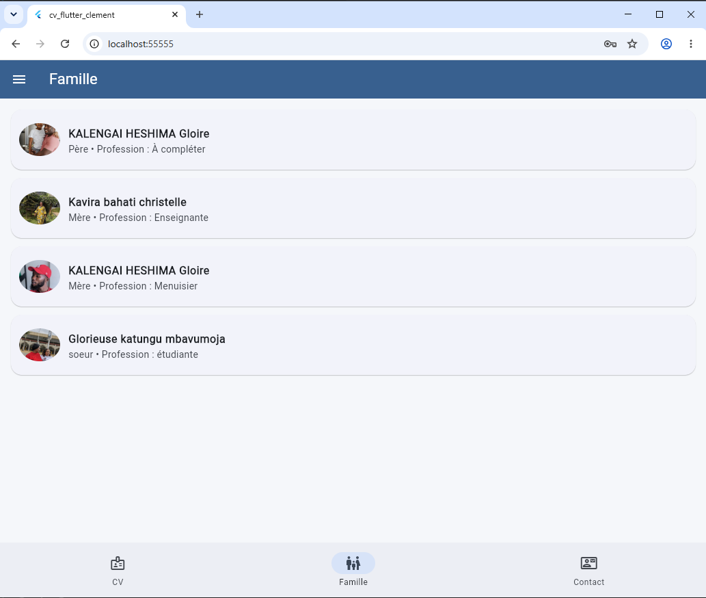
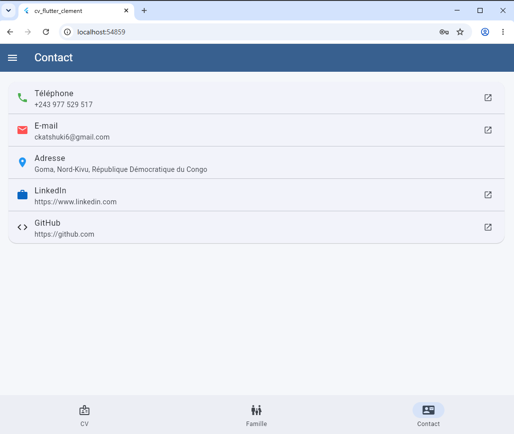

# CV Mobile Flutter — KATSHUKI HESHIMA Clément

Application mobile développée avec **Flutter** présentant mon profil professionnel (CV complet), les membres de ma famille et mes coordonnées de contact, accessible via une page de connexion et dotée d'une navigation fluide entre les pages.

## Captures d'écran

| Page 1 : Connexion | Page 2 : Accueil (CV) |
| :---: | :---: |
|  |  |

| Page 3 : Famille | Page 4 : Contact |
| :---: | :---: |
|  |  |

## Fonctionnalités
- **Page de connexion (`LoginPage`)** : Formulaire avec champ identifiant, champ mot de passe masqué et bouton **« Se connecter »**.
- **Page d'accueil / CV (`CvPage`)** : Photo de profil (`SafeAvatar`), identité, titre/profil, expériences, formation, compétences techniques et linguistiques, et centres d'intérêt.
- **Page Famille (`FamillePage`)** : Liste des membres de la famille avec photo (`SafeAvatar`), nom, lien de parenté et profession.
- **Page Contact (`ContactPage`)** : Coordonnées (téléphone, e-mail, adresse, LinkedIn, GitHub) et navigation rapide entre les pages une fois connecté.

## Installation et exécution

```bash
git clone [https://github.com/KatshukiHeshima/cv_flutter_clement.git](https://github.com/KatshukiHeshima/cv_flutter_clement.git)
cd cv_flutter_clement
flutter pub get
flutter run